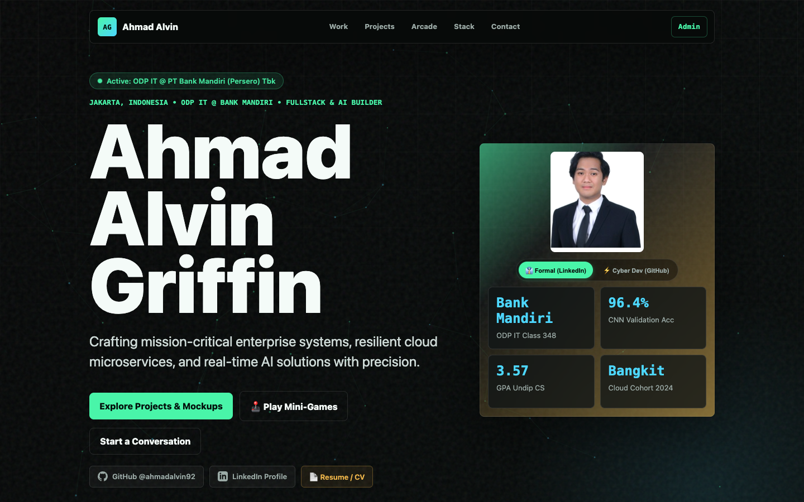
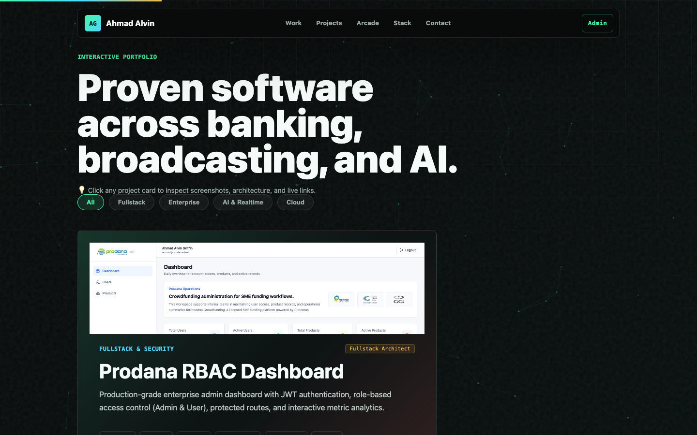
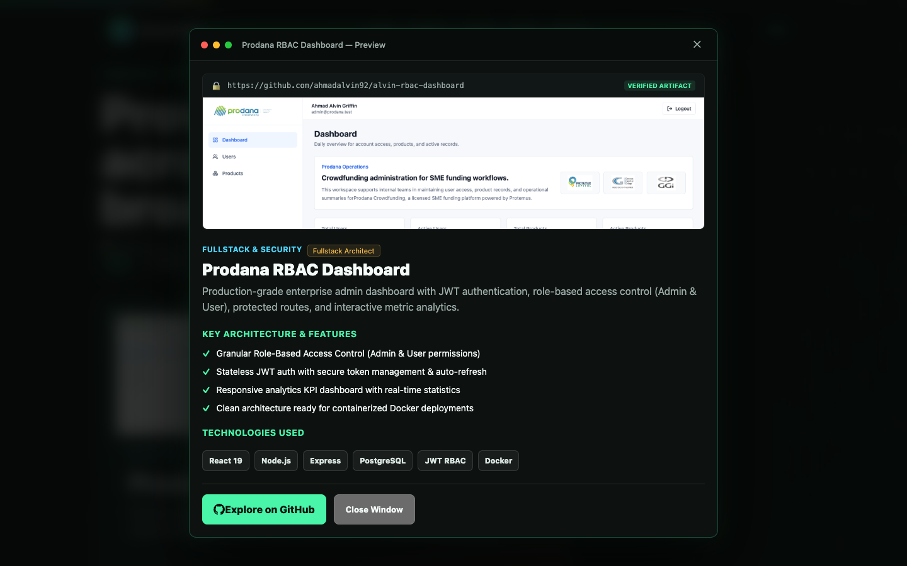
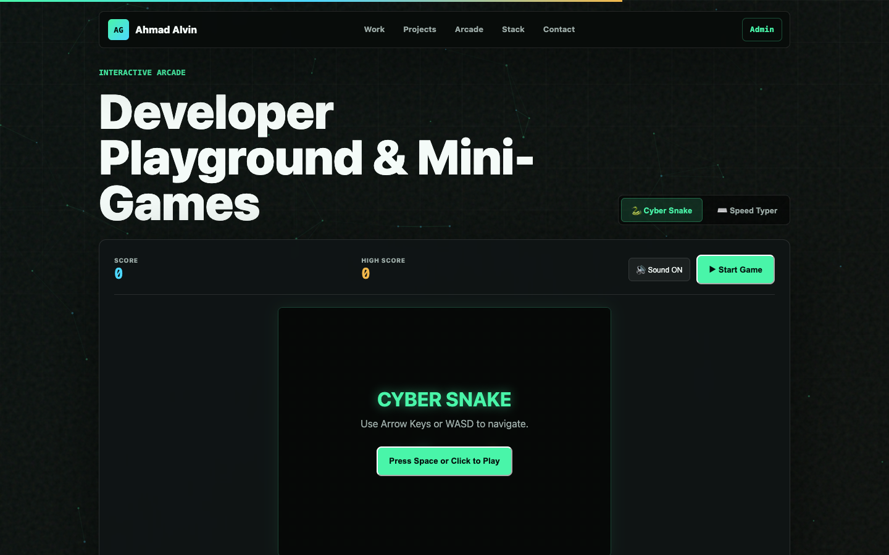

# 🚀 Ahmad Alvin Griffin — Tech Portfolio
### Modern Personal Techfolio & CMS • Next.js 15 • React 19 • TypeScript • Vercel

<p align="center">
  <a href="https://vinsky-techfolio.vercel.app/" target="_blank">
    
  </a>
  <a href="https://www.linkedin.com/in/ahmad-alvin-griffin/" target="_blank">
    
  </a>
  <a href="https://github.com/ahmadalvin92" target="_blank">
    
  </a>
</p>

Portfolio profesional personal yang menampilkan profil, keahlian, riwayat pengalaman kerja (**PT Bank Mandiri ODP IT**, **PT Radio Elshinta**, **PT Angkasa Pura II**, **Bangkit Academy**), proyek unggulan dengan **Interactive Frontend Mockup Preview**, panel CMS admin privat, dan **Developer Playground / Arcade** (Retro Cyber Snake & Code Speed Typer).

Setiap perubahan yang di-push ke branch `main` repositori GitHub ini akan **otomatis dideploy langsung ke Vercel** ([vinsky-techfolio.vercel.app](https://vinsky-techfolio.vercel.app/)).

---

## 📸 Dokumentasi Antarmuka (Screenshots)

### 🌟 1. Hero Profil Interaktif & Dual Photo Mode
| 👔 Formal Portrait (LinkedIn / Bank Mandiri) & Status ODP IT |
| :---: |
|  |
| *Dapat beralih mode antara foto formal LinkedIn dan avatar cyber developer GitHub secara instan* |

### 🚀 2. Interactive Projects Showcase & Frontend Mockup Modal
| Proyek Unggulan & Filter Kategori | Modal Preview & Arsitektur Sistem |
| :---: | :---: |
|  |  |
| *Grid proyek dengan screenshot visual, tag teknologi & badge peran* | *Klik kartu proyek untuk membuka jendela browser mockup, fitur & link GitHub* |

### 🕹️ 3. Developer Playground & Mini-Games
| 🐍 Retro Cyber Snake & ⌨️ Code Speed Typer |
| :---: |
|  |
| *Mini-game interaktif beranimasi neon, score/high-score, sound synthesizer & tantangan mengetik kode WPM* |

---

## ✨ Fitur-Fitur Utama

- **⚡ Next.js 15 App Router & React 19**: Performa ultra cepat, render server-side hybrid, dan transisi fluid tanpa lag.
- **👔 Dual Photo Mode Toggle**: Pengunjung dapat memilih tampilan foto profil formal LinkedIn (Bank Mandiri ODP IT) atau avatar cyber developer GitHub.
- **🔍 Clickable Project Modal & Live Mockup**: Setiap kartu proyek dapat diklik untuk memunculkan modal bergaya browser mockup dengan tangkapan layar antarmuka asli, ringkasan arsitektur, dan tautan langsung ke repositori GitHub.
- **🕹️ Built-in Dev Arcade (Mini-Games)**:
  - **🐍 Cyber Snake**: Game ular klasik bernuansa neon cyberpunk dengan skor, high score lokal, sound effect synthesizer (Web Audio API), tombol keyboard (WASD/Panah), dan on-screen touch D-Pad untuk pengguna mobile.
  - **⌨️ Code Speed Typer**: Tantangan uji kecepatan mengetik cuplikan kode nyata (TypeScript, Python AI, SQL Banking, React WebSockets) lengkap dengan kalkulasi WPM dan akurasi karakter real-time.
- **🛡️ Resilient Fallback Data System**: Konten publik tetap tampil lengkap dengan 10 proyek unggulan meski tanpa koneksi database eksternal.
- **🔒 Dedicated Admin CMS (`/admin`)**: Dashboard privat untuk memutakhirkan profil, proyek, timeline pengalaman kerja, dan keterampilan secara real-time.
- **☁️ Continuous Deployment via Vercel**: Sinkronisasi otomatis dari branch `main` GitHub ke produksi di [vinsky-techfolio.vercel.app](https://vinsky-techfolio.vercel.app/).

---

## 🛠️ Tech Stack & Ekosistem

| Komponen | Teknologi | Deskripsi |
| :--- | :--- | :--- |
| **Framework Utama** | [Next.js 15](https://nextjs.org/) + [React 19](https://react.dev/) | App Router modern, Server Components, dan Client interactivity |
| **Bahasa Pemrograman** | [TypeScript 5](https://www.typescriptlang.org/) | Strict static typing untuk memastikan keamanan tipe end-to-end |
| **Styling & Theme** | CSS3 Modern Design System | Custom neon cyber aesthetic, glassmorphism, responsive grid & typography |
| **Interactive Games** | HTML5 Canvas, Web Audio API | Zero external game dependencies, lightweight 60fps performance |
| **Database & Auth** | Supabase (PostgreSQL) + Auth | Cloud persistence untuk CMS admin dengan in-memory fallback |
| **Deployment & Hosting**| [Vercel](https://vercel.com/) | Automated git-push deployment pipeline |

---

## 📁 Struktur Direktori

```text
Vinsky-Techfolio/
├── app/                     # Next.js App Router (Routes & Layouts)
│   ├── admin/               # Halaman login & dashboard admin CMS
│   ├── api/                 # API route handlers
│   ├── layout.tsx           # Root layout & meta tags SEO
│   └── page.tsx             # Halaman utama public portfolio
├── components/              # Komponen antarmuka modular
│   ├── About.tsx            # Bagian perkenalan diri
│   ├── AdminPanel.tsx       # Antarmuka pengelolaan data CMS
│   ├── Contact.tsx          # Form kontak & social media link
│   ├── Experience.tsx       # Timeline pengalaman kerja
│   ├── Hero.tsx             # Hero section interaktif
│   ├── Navbar.tsx           # Navigasi sticky
│   ├── Projects.tsx         # Showcase kartu project
│   └── Skills.tsx           # Grid keahlian teknis
├── lib/                     # Utilitas, tipe data, konfigurasi Supabase
├── public/                  # Aset statis (foto profil, CV, icon)
├── screenshots/             # Dokumentasi screenshot aplikasi
├── supabase/
│   └── schema.sql           # Skema DDL tabel database Supabase
├── .env.example             # Contoh template variabel lingkungan
├── package.json             # Manifest paket & dependensi
└── tsconfig.json            # Konfigurasi TypeScript
```

---

## ⚙️ Prasyarat Sistem

Sebelum menjalankan aplikasi, pastikan sistem Anda telah terpasang:
- **Node.js**: Versi `20.x` LTS atau lebih tinggi
- **npm**: Versi `10.x` atau lebih baru
- Akun **Supabase** *(opsional untuk melihat tampilan publik, wajib jika ingin menggunakan Admin CMS)*

---

## 🚀 Panduan Instalasi & Menjalankan Lokal

### 1. Clone Repositori
```bash
git clone https://github.com/ahmadalvin92/Vinsky-Techfolio.git
cd Vinsky-Techfolio
```

### 2. Instalasi Dependensi
```bash
npm install
```

### 3. Konfigurasi Environment Variables
Salin template konfigurasi `.env.example` menjadi `.env.local`:
```bash
cp .env.example .env.local
```

Buka `.env.local` lalu isi kredensial Supabase Anda:
```env
NEXT_PUBLIC_SUPABASE_URL=https://your-project.supabase.co
NEXT_PUBLIC_SUPABASE_PUBLISHABLE_KEY=your-supabase-publishable-key
ADMIN_EMAIL=your-admin-email@example.com
```
> **Catatan:** Jangan pernah membagikan atau mengunggah file `.env.local` ke repositori publik.

### 4. Konfigurasi Database Supabase *(Opsional untuk CMS)*
1. Masuk ke dashboard [Supabase](https://supabase.com).
2. Buat proyek baru.
3. Masuk ke menu **SQL Editor**, buka file `supabase/schema.sql`, salin seluruh kodenya lalu klik **Run**.
4. Masuk ke menu **Authentication > Users**, klik **Invite User** atau buat user baru dengan email yang sama seperti nilai `ADMIN_EMAIL`.
5. Pastikan metode autentikasi Email & Password aktif.

### 5. Jalankan Server Pengembangan
```bash
npm run dev
```
Buka browser dan akses:
- **Halaman Publik**: [http://localhost:3000](http://localhost:3000)
- **Panel Admin**: [http://localhost:3000/admin](http://localhost:3000/admin)

---

## 📜 Daftar Skrip NPM

| Perintah | Fungsi |
| :--- | :--- |
| `npm run dev` | Menjalankan local development server dengan hot reload |
| `npm run build` | Melakukan build produksi teroptimasi |
| `npm run start` | Menjalankan aplikasi dalam mode produksi |
| `npm run lint` | Melakukan pemeriksaan kode dengan ESLint |

---

## 🚢 Panduan Deployment ke Vercel

1. Push perubahan terbaru repositori Anda ke GitHub.
2. Buka [Vercel Dashboard](https://vercel.com) dan klik **Add New > Project**.
3. Hubungkan repositori `Vinsky-Techfolio`.
4. Masukkan **Environment Variables**:
   - `NEXT_PUBLIC_SUPABASE_URL`
   - `NEXT_PUBLIC_SUPABASE_PUBLISHABLE_KEY`
   - `ADMIN_EMAIL`
5. Klik **Deploy**. Vercel akan otomatis melakukan build dan menyediakan URL live.

---

## 👨‍💻 Author

**Ahmad Alvin Griffin**  
- GitHub: [@ahmadalvin92](https://github.com/ahmadalvin92)
- LinkedIn: [Ahmad Alvin](https://www.linkedin.com/in/ahmad-alvin)
- Lokasi: Jakarta, Indonesia
