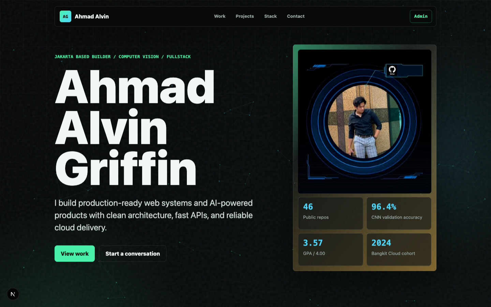
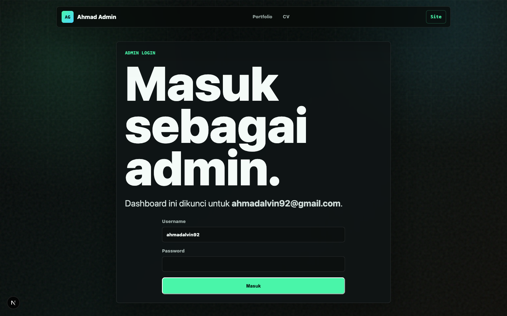

# 🚀 Ahmad Alvin Griffin — Tech Portfolio
### Modern Personal Techfolio & CMS • Next.js 15 • React 19 • TypeScript • Supabase

Portfolio profesional personal yang menampilkan profil, keahlian, riwayat pengalaman kerja, proyek unggulan, dan kontak **Ahmad Alvin Griffin**. Dilengkapi dengan panel CMS admin privat berbasis Supabase Auth & PostgreSQL, serta resilient fallback system agar portofolio publik tetap dapat diakses dengan cepat meski tanpa koneksi database eksternal.

---

## 📸 Preview & Screenshots

### 🌐 Public Portfolio (Dark Futuristic Theme)
<p align="center">
  
</p>

### 🔐 Admin Panel & Authentication
<p align="center">
  
</p>

---

## ✨ Fitur Utama

- **⚡ Fast & Modern UI**: Dibangun menggunakan Next.js 15 App Router & React 19 dengan performa tinggi dan transisi halus.
- **🎨 Futuristic Cyber-Minimalist Design**: Skema warna gelap beraksen neon/emerald dengan tata letak responsif untuk desktop, tablet, dan smartphone.
- **🛡️ Fallback Data System**: Konten publik tetap tampil sempurna menggunakan data cadangan terstruktur (*in-memory fallback*) bila koneksi database Supabase belum terkonfigurasi.
- **🔒 Dedicated Admin CMS (`/admin`)**: Dashboard privat untuk memutakhirkan profil, proyek, timeline pengalaman kerja, dan keterampilan secara real-time.
- **🔑 Secure Authentication**: Sistem login aman khusus administrator menggunakan Supabase Auth (Email & Password).
- **🗄️ PostgreSQL Database**: Penyimpanan data relasional berbasis cloud melalui Supabase dengan skema SQL otomatis (`supabase/schema.sql`).
- **☁️ Cloud & Vercel Ready**: Konfigurasi deployment instan untuk Vercel atau server containerized.

---

## 🛠️ Tech Stack & Bahasa Pemrograman

| Komponen | Teknologi | Deskripsi |
| :--- | :--- | :--- |
| **Bahasa Utama** | `TypeScript`, `JavaScript` | Static typing ketat untuk keandalan kode frontend & backend routes |
| **Framework Frontend** | `Next.js 15 (App Router)`, `React 19` | Server Components, Client Components, dan SEO-optimized routing |
| **Styling & Design** | `Vanilla CSS`, `CSS Modules` | Desain glassmorphism, typography Outfit/Inter, dan micro-animations |
| **Backend & Database** | `Supabase (PostgreSQL)` | Database cloud relasional dan REST/Realtime Client |
| **Authentication** | `Supabase Auth` | Manajemen sesi admin dan proteksi route panel admin |
| **Runtime & Tooling** | `Node.js 20+`, `npm` | Build tool terintegrasi Turbopack / Webpack Next.js |
| **Deployment** | `Vercel` / Node server | Automated CI/CD pipeline |

---

## 📁 Struktur Direktori

```text
Vinsky-Techfolio/
├── app/                     # Next.js App Router (Routes & Layouts)
│   ├── admin/               # Halaman login & dashboard admin CMS
│   ├── api/                 # API route handlers
│   ├── layout.tsx           # Root layout & meta tags SEO
│   └── page.tsx             # Halaman utama public portfolio
├── components/              # Komponen antarmuka modular
│   ├── About.tsx            # Bagian perkenalan diri
│   ├── AdminPanel.tsx       # Antarmuka pengelolaan data CMS
│   ├── Contact.tsx          # Form kontak & social media link
│   ├── Experience.tsx       # Timeline pengalaman kerja
│   ├── Hero.tsx             # Hero section interaktif
│   ├── Navbar.tsx           # Navigasi sticky
│   ├── Projects.tsx         # Showcase kartu project
│   └── Skills.tsx           # Grid keahlian teknis
├── lib/                     # Utilitas, tipe data, konfigurasi Supabase
├── public/                  # Aset statis (foto profil, CV, icon)
├── screenshots/             # Dokumentasi screenshot aplikasi
├── supabase/
│   └── schema.sql           # Skema DDL tabel database Supabase
├── .env.example             # Contoh template variabel lingkungan
├── package.json             # Manifest paket & dependensi
└── tsconfig.json            # Konfigurasi TypeScript
```

---

## ⚙️ Prasyarat Sistem

Sebelum menjalankan aplikasi, pastikan sistem Anda telah terpasang:
- **Node.js**: Versi `20.x` LTS atau lebih tinggi
- **npm**: Versi `10.x` atau lebih baru
- Akun **Supabase** *(opsional untuk melihat tampilan publik, wajib jika ingin menggunakan Admin CMS)*

---

## 🚀 Panduan Instalasi & Menjalankan Lokal

### 1. Clone Repositori
```bash
git clone https://github.com/ahmadalvin92/Vinsky-Techfolio.git
cd Vinsky-Techfolio
```

### 2. Instalasi Dependensi
```bash
npm install
```

### 3. Konfigurasi Environment Variables
Salin template konfigurasi `.env.example` menjadi `.env.local`:
```bash
cp .env.example .env.local
```

Buka `.env.local` lalu isi kredensial Supabase Anda:
```env
NEXT_PUBLIC_SUPABASE_URL=https://your-project.supabase.co
NEXT_PUBLIC_SUPABASE_PUBLISHABLE_KEY=your-supabase-publishable-key
ADMIN_EMAIL=your-admin-email@example.com
```
> **Catatan:** Jangan pernah membagikan atau mengunggah file `.env.local` ke repositori publik.

### 4. Konfigurasi Database Supabase *(Opsional untuk CMS)*
1. Masuk ke dashboard [Supabase](https://supabase.com).
2. Buat proyek baru.
3. Masuk ke menu **SQL Editor**, buka file `supabase/schema.sql`, salin seluruh kodenya lalu klik **Run**.
4. Masuk ke menu **Authentication > Users**, klik **Invite User** atau buat user baru dengan email yang sama seperti nilai `ADMIN_EMAIL`.
5. Pastikan metode autentikasi Email & Password aktif.

### 5. Jalankan Server Pengembangan
```bash
npm run dev
```
Buka browser dan akses:
- **Halaman Publik**: [http://localhost:3000](http://localhost:3000)
- **Panel Admin**: [http://localhost:3000/admin](http://localhost:3000/admin)

---

## 📜 Daftar Skrip NPM

| Perintah | Fungsi |
| :--- | :--- |
| `npm run dev` | Menjalankan local development server dengan hot reload |
| `npm run build` | Melakukan build produksi teroptimasi |
| `npm run start` | Menjalankan aplikasi dalam mode produksi |
| `npm run lint` | Melakukan pemeriksaan kode dengan ESLint |

---

## 🚢 Panduan Deployment ke Vercel

1. Push perubahan terbaru repositori Anda ke GitHub.
2. Buka [Vercel Dashboard](https://vercel.com) dan klik **Add New > Project**.
3. Hubungkan repositori `Vinsky-Techfolio`.
4. Masukkan **Environment Variables**:
   - `NEXT_PUBLIC_SUPABASE_URL`
   - `NEXT_PUBLIC_SUPABASE_PUBLISHABLE_KEY`
   - `ADMIN_EMAIL`
5. Klik **Deploy**. Vercel akan otomatis melakukan build dan menyediakan URL live.

---

## 👨‍💻 Author

**Ahmad Alvin Griffin**  
- GitHub: [@ahmadalvin92](https://github.com/ahmadalvin92)
- LinkedIn: [Ahmad Alvin](https://www.linkedin.com/in/ahmad-alvin)
- Lokasi: Jakarta, Indonesia
